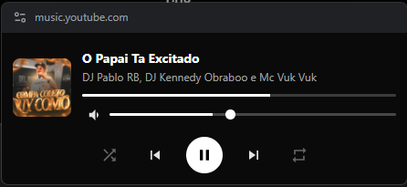
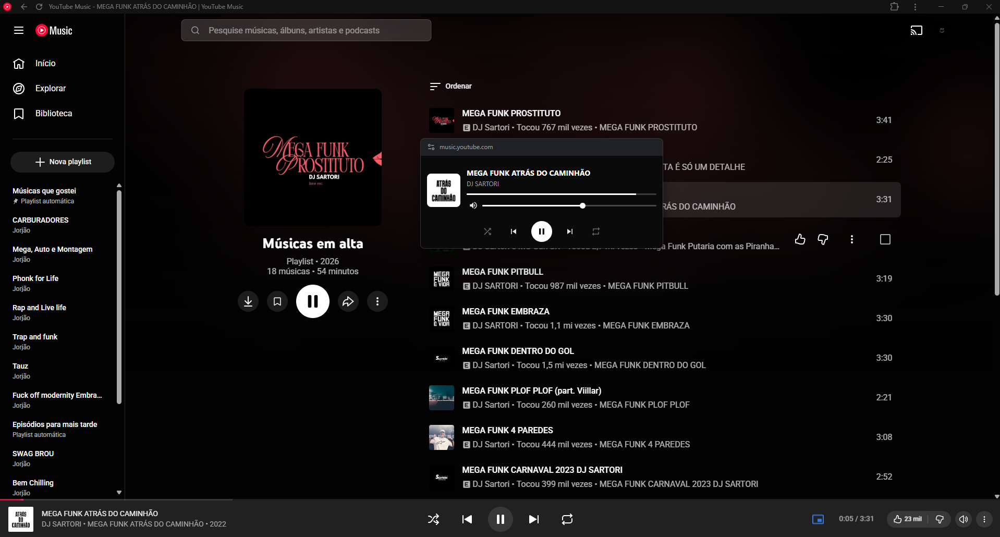
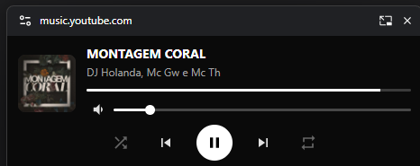
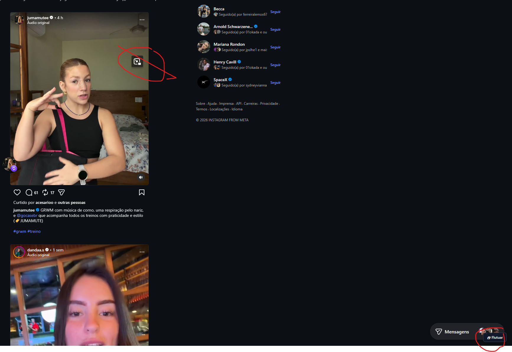
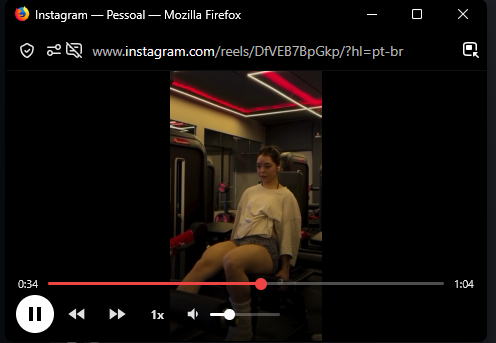
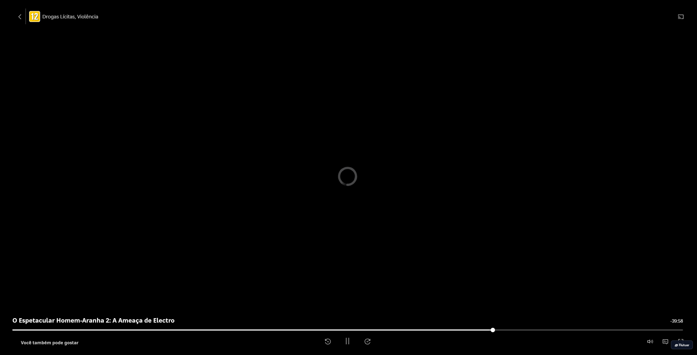
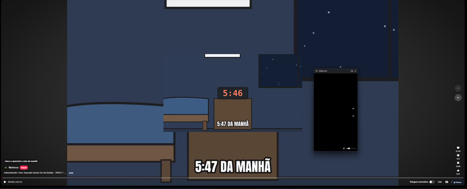
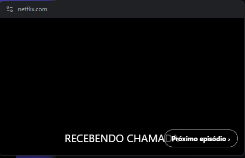

# Bugs encontrados

Lista dos bugs relatados. As correções entram no PR "Correções de bugs" e saem juntas na próxima versão.

| # | Status | Onde | Bug | Versão |
|---|--------|------|-----|--------|
| 1 | Corrigido na 3.0 | YouTube Music | O controle de volume da janela parece não subir (fica baixo mesmo com o volume alto). Causa: a normalização de volume do YouTube deixa o `<video>` mais baixo que o volume do site, e a janela lia o `<video>`. Agora a janela segue o volume do player (o mesmo do site).  | 2.0.1 |
| 2 | Corrigido na 3.1.0 — confirmar | YouTube Music | Quando a música acaba e passa para a próxima, a barra de progresso não volta ao começo. Causa provável: com reprodução sem pausa entre faixas, o `<video>` continua contando o tempo da música anterior. Na 3.0.1 a barra passou a ler o tempo mostrado pelo site, mas não achava o texto no layout atual. Agora o tempo vem da API do próprio player (o mesmo de "0:05 / 3:31" da barra), e o clique na barra também usa a API.   | 2.0.1, 3.0.1 |
| 3 | Corrigido na 3.0.1 | Instagram (e TikTok) | O botão "🗗 Flutuar" no canto da tela fica em cima da barra "Mensagens" do Instagram. Agora, no Instagram e no TikTok, o ícone aparece no canto do vídeo ao passar o mouse, sem botão fixo na tela. O ícone no canto do vídeo é o picture-in-picture do próprio Firefox, não da extensão.  | 3.0.0 |
| 4 | Corrigido na 3.0.1 | Instagram | Aberto pela página inicial ou pelo perfil, o reel vinha com a janela de vídeo comum (linha do tempo, ±10 s). Agora a página inicial usa o layout de feed (setas ▲ ▼ vão para o próximo vídeo, pulando fotos) e no perfil a extensão fica desligada.  | 3.0.0 |
| 5 | Corrigido na 3.0.1 | Streamings (ex.: Max) | O botão "🗗 Flutuar" no canto ficava em cima da barra do player. Agora o ícone entra na barra do player, ao lado da tela cheia, como no YouTube; com a opção "Streamings, TikTok e Instagram" ativada no menu ele aparece sozinho.  | 3.0.0 |
| 6 | Removido na 3.0.1 | Menu da extensão | "Flutuar mídia desta aba" e "Abrir um link numa janela compacta" eram confusos (pediam um clique extra na página). Saíram do menu; continuam o ícone na barra, Alt+P, Alt+Shift+P e o botão direito. | 3.0.0 |
| 7 | Corrigido na 3.0.1 — confirmar | TikTok | A janela flutuante fica preta (o vídeo continua na página). Causa provável: o player do TikTok reinicia o `<video>` quando ele sai da página. Agora, no TikTok, a janela mostra um espelho do vídeo (`captureStream`) e o original fica no lugar; se o navegador não deixar espelhar, volta ao jeito antigo. O botão "Flutuar" em cima da barra do TikTok já saiu na 3.0.1.  | 2.0.1 |
| 8 | Corrigido na 3.1.0 — confirmar | Netflix | "Próximo episódio ›" aparecia na janela logo no começo do episódio. Causa: a barra do player da Netflix tem um botão "Próximo episódio" o tempo todo. Agora, quando o botão é achado pelo texto, ele só aparece nos últimos 2 minutos. Também: o botão da janela passa a copiar o visual do botão do site (cor, borda, cantos).  | 3.0.1 |
| 9 | Corrigido na 3.1.1 | Shorts, TikTok, Reels | Fechar a janela enquanto o site ainda trocava de vídeo (seta, rolagem ou auto-avançar) levava o próximo vídeo para a janela já fechada: ele sumia da página até recarregar. | 3.1.0 (análise do código) |
| 10 | Corrigido na 3.1.1 | Menu da extensão | Os botões −10 s / +10 s respondiam "Nenhum vídeo encontrado" com a janela flutuante aberta (o vídeo sai da página e a busca não o achava). | 3.1.0 (análise) |
| 11 | Corrigido na 3.1.1 | YouTube Shorts | Sem ícone para abrir a janela (a barra do player comum não existe nos Shorts): só Alt+P funcionava. Agora aparece o ícone em cima do vídeo, como no TikTok e Instagram. | 3.1.0 (análise) |
| 12 | Corrigido na 3.1.1 — confirmar | YouTube Shorts | Vindo de um vídeo comum, o volume da janela mexia no player escondido do vídeo anterior, não no Short. A ponte de volume agora usa o player dos Shorts. | 3.1.0 (análise) |
| 13 | Corrigido na 3.1.1 | Todas as abas | Tamanho da janela e tamanho da legenda lembrados: uma aba apagava o que outra aba tinha salvo (cada aba guardava uma cópia antiga). | 3.1.0 (análise) |
| 14 | Corrigido na 3.1.1 | Idiomas | Navegador em idioma sem tradução (francês, alemão...) mostrava a janela e o menu em português; agora usa inglês. O aviso de "página não aceita extensões" do menu não era traduzido. | 3.1.0 (análise) |
| 15 | Corrigido na 3.1.1 | Todos | Dois cliques rápidos no ícone abriam a janela e mostravam junto o aviso "O navegador não permitiu abrir". | 3.1.0 (análise) |
| 16 | Corrigido na 3.1.1 | Spotify | Com "tempo restante" ligado no site ("-2:10"), a barra de progresso da janela ficava zerada. | 3.1.0 (análise) |
| 17 | Corrigido na 3.1.1 | Streamings e outros sites | A procura por "Pular abertura"/"Próximo episódio" lia o texto de todos os botões e links da página a cada 0,6 s de um jeito pesado; e rodava também no TikTok/Instagram. Ficou leve e fora dos feeds. O ícone em cima do vídeo também media todos os vídeos a cada movimento do mouse. | 3.1.0 (análise) |
| 18 | Corrigido na 3.1.1 | Sites com vários vídeos | O ícone em cima de um vídeo abria outro (o que estava tocando ou o maior). Agora abre o vídeo em que o mouse está. | 3.1.0 (análise) |
| 19 | Corrigido na 3.1.1 | TikTok | O espelho do vídeo (`captureStream`) não era encerrado ao trocar de vídeo ou fechar a janela. | 3.1.0 (análise) |
| 20 | Aberto | Todos | Depois que a extensão atualiza, abas já abertas ficam com o script antigo: o ícone continua funcionando, mas o botão direito e o Alt+Shift+P só voltam ao recarregar a aba. | 3.1.0 (análise) |
| 21 | Aberto — testar | TikTok no Firefox | O som passa pelo espelho; ao fechar a janela o vídeo original pode ficar mudo até o próximo vídeo (comportamento do `mozCaptureStream`). | 3.1.0 (análise) |

## Como relatar

- Site (ex.: YouTube Music, Globoplay, TikTok)
- Navegador e versão do FloatMini (`chrome://extensions` ou `about:addons`)
- O que aconteceu e o que era esperado
- Print da janela flutuante; se for legenda ou botão do site, print do **Inspecionar** no elemento
