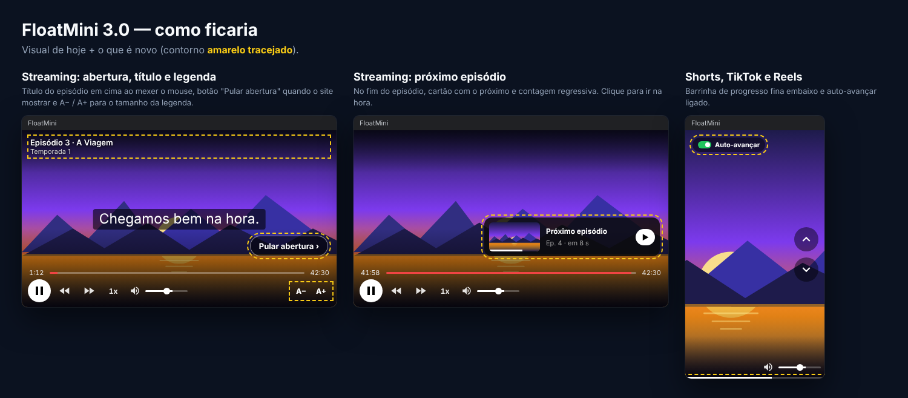

# Roadmap — FloatMini 3.0 ("mega atualização")

Ideias guardadas para a 3.0. Nada disto está implementado ainda.

Na imagem, o que é novo está com contorno amarelo tracejado. O "Auto-avançar" pode ficar na janela ou só no menu da extensão (a decidir).

## Shorts, TikTok e Reels (decidido)

1. **Auto-avançar** — opção no menu: quando o vídeo acaba, a janela vai sozinha para o próximo.
2. **Alt+P e ícone no TikTok/Instagram** — botão "Ativar no TikTok/Instagram" no menu que pede a permissão só para quem quiser (`optional_host_permissions`), sem desativar a extensão de todo mundo numa atualização.
3. **Barrinha de progresso fina** — linha de 2 px embaixo, sem números, só para ver quanto falta.
4. **Lembrar tamanho/posição da janela em pé** — separado do tamanho da janela de vídeo normal.
5. **Curtir com duplo clique** — clica no "curtir" do site. Por último: mexe na conta e os sites mudam com frequência.

## Streaming (decidido)

1. **Pular abertura / recapitulação / créditos** — quando o site mostra o botão, ele aparece também na janela flutuante (opção: pular sozinho).
2. **Próximo episódio** — botão na janela quando o site oferece o próximo episódio.
3. **Tamanho da legenda** — A− / A+ na janela, lembrado por site.
4. **Título do episódio** — nome do episódio aparece discreto em cima ao mexer o mouse.
5. **Avançar/voltar por site** — conferir em cada streaming (Max, Globoplay, Disney+, Prime) se mudar o tempo direto funciona ou se precisa da API do player, como na Netflix.
